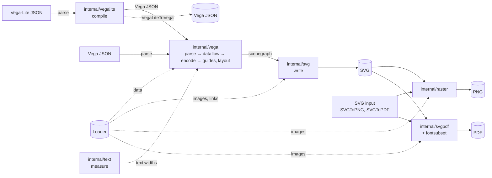
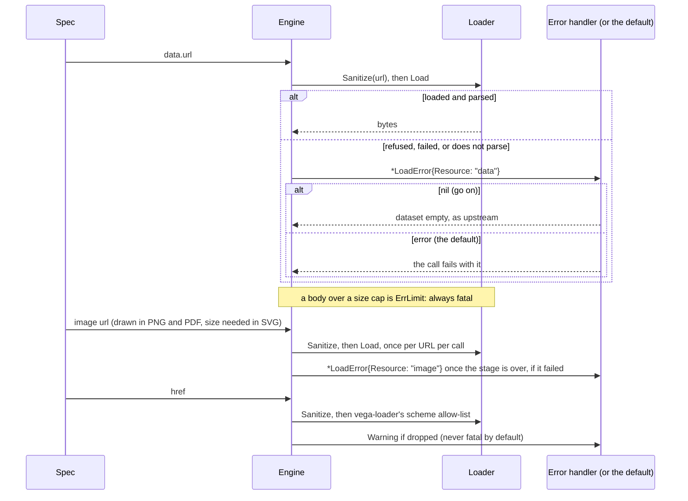

# Architecture

Aster is a Go implementation of Vega's runtime and Vega-Lite's compiler, organised along upstream's own module boundaries, so a behaviour can be traced to the upstream module it follows. Everything lives in the module root (the public API) and `internal/`. This page is the map. [design-rules.md](design-rules.md) holds the rules the code follows, [testing.md](testing.md) how it is checked against upstream, and [adr/](adr/) why it is built this way.

## A render

Every output starts as Vega: Vega-Lite is compiled to it first, and PNG and PDF are made *from the SVG*. So anything visible in a PNG or PDF is in the SVG first, and one call's timeout, budgets and image cache span all its stages.



| Stage | Package | Upstream counterpart |
|---|---|---|
| parse JSON | `jsval` | `JSON.parse`, with JavaScript's value model |
| compile Vega-Lite | `vegalite` | vega-lite |
| parse Vega, run the dataflow, encode marks, lay out guides | `vega` (+ `vega/guides`, `vega/layout`) | vega-parser, vega-dataflow, vega-runtime, vega-view, vega-encode, vega-view-transforms |
| expressions | `expr` | vega-expression, vega-functions |
| transforms | `transforms` (+ `contour`, `force`, `hierarchy`, `label`, `voronoi`, `wordcloud`) | vega-transforms, vega-statistics, vega-regression, vega-hierarchy, vega-force, vega-voronoi, vega-label, vega-wordcloud |
| scales, colours | `scale` (+ `scale/color`) | d3-scale, vega-scale, d3-interpolate, d3-color, d3-scale-chromatic |
| number and time formats | `format` | d3-format, d3-time, d3-time-format, vega-format, vega-time |
| projections, geo paths | `geo` (+ `geo/geoscene`) | d3-geo, d3-geo-projection, vega-projection, vega-geo |
| scenegraph, bounds, mark paths | `scene` | vega-scenegraph |
| SVG output | `svg` | vega-scenegraph's `SVGStringRenderer`, byte for byte |
| text measurement and shaping | `text` (forme) | node-canvas / the browser's canvas |
| SVG → PNG | `raster`, `pngopt` | resvg (the reference it is tested against) |
| SVG → PDF | `svgpdf`, `fontsubset` | none |
| JavaScript's numbers, `Math` and sort | `jsval`, `jsmath`, `jssort` | V8, bit for bit |
| resource budgets, the per-call ledger, byte-bounded caches | `budget`, `bcache` | none (aster's own bounds) |
| loaders | `loader` | vega-loader's policy |
| image references, CSS colours, embedded fonts | `imageref`, `csscolor`, `fonts/liberation`, `fonts/notoemoji` | none |
| cutting text to a byte bound at a character boundary (warnings, quoted input, measured text) | `textcut` | none |

## Resources and errors

Every resource a specification names goes through the configured Loader. What happens when one fails is decided per call ([errors.md](errors.md)): by default the call fails, and with `WithErrorHandler` the handler decides.



## A Converter's life

```mermaid
stateDiagram-v2
  [*] --> Ready: New(opts) validates every option (version, time zone, theme, Loader, fonts and families); loads the fonts given to it
  Ready --> Rendering: a call (any number at once)
  Rendering --> Ready: returns
  note right of Rendering: with the embedded fonts alone, the first call needing text loads them
  Ready --> Closed: Close()
  Rendering --> Closed: Close() cancels calls in flight (context.Canceled), waits for them, closes the Loader if io.Closer
  Closed --> Closed: every call returns ErrClosed; a later Close returns nil (the Loader's Close error comes once, from the first Close made outside a call)
```



Concurrency is by construction: a call's dataflow, scenegraph, random generator, budgets, ledger and deadline are its own. What calls share (fonts and their shaping caches, colour schemes, compiled expressions) is immutable or synchronised, and the caches among it are bounded by the bytes they hold (`bcache`). The rules that keep it so are in [design-rules.md](design-rules.md#concurrency).

## Package layers

Each package imports only packages of lower layers, so there are no cycles and the foundations know nothing of what is built on them. `TestPackageLayers` checks this list against the imports of every package, so it cannot drift: a new package must be added, and an import that goes up a layer fails.

<!-- layers:begin (checked by TestPackageLayers) -->
```text
0: bcache budget csscolor fonts/dejavu fonts/liberation fonts/notoemoji fontsubset jsmath jssort textcut
1: imageref jsval loader pngopt text
2: format geo raster scale/color scene transforms/contour transforms/force transforms/hierarchy transforms/label transforms/voronoi transforms/wordcloud
3: expr geo/geoscene scale svg svgpdf transforms vega/layout
4: vega/guides vegalite
5: vega
6: aster
tools: cmd/enginebench cmd/recursionaudit cmd/testsummary cmd/vectors fuzzutil fuzzutil/confusion oracle svgcheck svgdiff testutil upstream vectors
```
<!-- layers:end -->

`tools` are not part of the engine: the commands and the test harness (`oracle` drives upstream in node, `svgcheck` checks the structure of the engine's SVG, `svgdiff` compares SVG, `upstream` replays upstream's test suites, `fuzzutil` serves the fuzz targets and `fuzzutil/confusion` the type-confusion differentials, `testutil` holds the race slowdown that keeps time-based tests independent of the machine, and builds synthetic fonts for tests). `internal/fonts/dejavu` is imported by tests only.

<!-- deps:begin (checked by TestDependencyStatement) -->
Beyond the standard library, a program that imports aster builds these modules, and no others:

- `github.com/mgilbir/forme` (text shaping), `github.com/mgilbir/goecma262` (regular expressions) and `github.com/mgilbir/pdf0` (PDF writing), the owner's;
- through pdf0, also `golang.org/x/text` (pdf0 normalises a PDF password with it) and the owner's: `github.com/mgilbir/golittlecms` (colour management), `github.com/mgilbir/gopenjpeg` (JPEG 2000) and `github.com/mgilbir/formalis` (electronic invoices).

The engine's own packages import none of x/text: JavaScript's case mapping is jsval's tables, recorded from node, not x/text's, whose tables follow the Go toolchain's Unicode version (`TestNoXTextInTheEngine`).
<!-- deps:end -->

`golang.org/x/image` is required by tests only.
