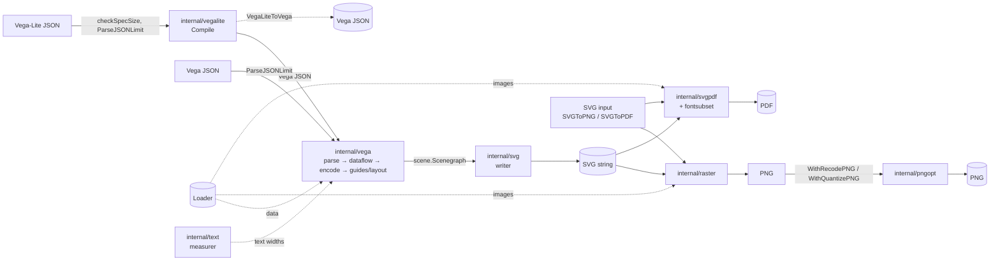
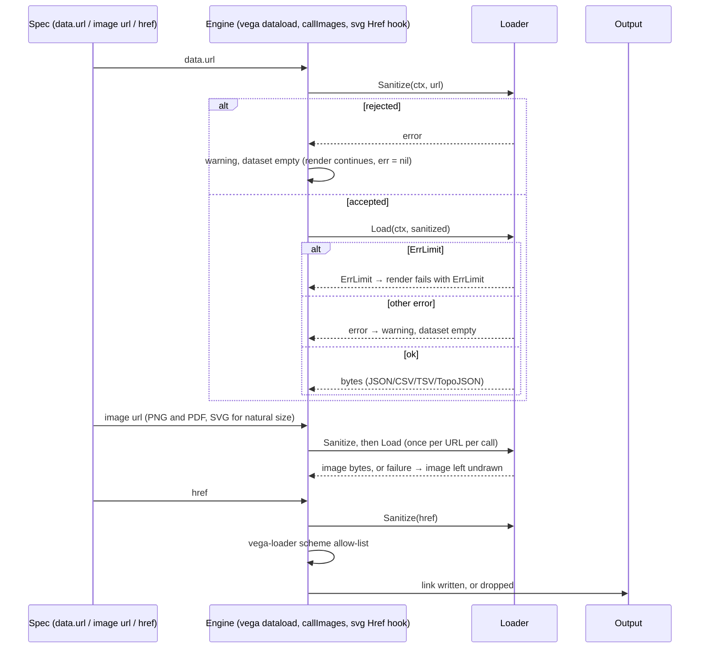
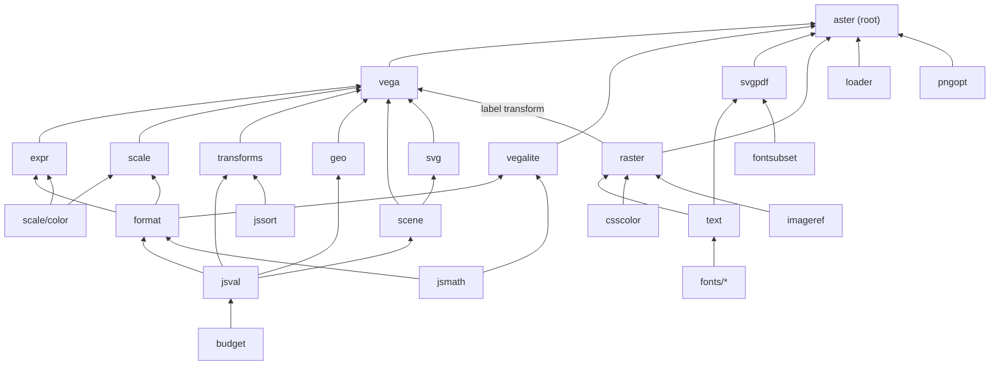
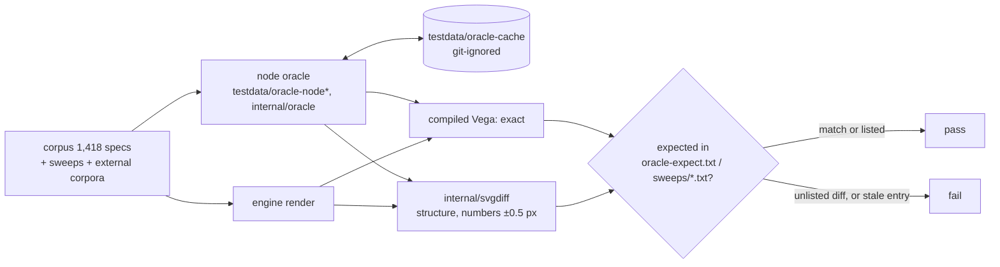

# Documentation audit — 2026-10-11

Audit of every reader-facing documentation surface of `github.com/mgilbir/aster` at `bfd128b` (main, = tag v0.1.1): README, `docs/**`, the in-tree Markdown under `internal/` and `testdata/`, the root package's godoc, every internal package doc comment, the CLI's `-h`, the Makefile, `scripts/*.sh` headers and the CI workflows. Each accuracy claim was checked against the code or by running it (CLI built from HEAD, throwaway Go programs against the module via `replace`, `go doc`, `go list`, file counts). **CONFIRMED** = reproduced or read in code; **PLAUSIBLE** = suspected, not reproduced.

**Bottom line.** The docs are dense, mostly accurate and unusually honest about limits — but five claims that users act on are wrong or missing (schema auto-detection, font priority, silent load failures, memory-limit semantics, the Loader contract), the README carries four documents in one file, and there is not a single diagram in the repository.

> **Resolution (2026-10-11, branch `docs-audit-fixes`, uncommitted).** Fixed: D1 (CLI detects by `$schema`, then shape; `-from`), D3 (errors reach the caller: `*LoadError`, `WithErrorHandler`, `ErrClosed`), and D33 below (embedded `data:` images were refused by the default loader), in code with tests. D4–D32 are fixed in the docs and godoc, with the README split into `docs/`. D4 and D7 are kept true by tests (`TestLimitsDocMatchesCode`, `TestPackageLayers`); D8's Vega-schema floor was raised to 7,549; D9's `check.sh` now runs CI's gates. D2 changed in code too: a registered family is made of the faces registered for it (the last of equal fit wins), and `WithFontFallback` sets the fallback chain. The `.gitignore` line from D25 is fixed. Since this audit, `docs/DESIGN.md` is `docs/design-rules.md`, `docs/SECURITY_REVIEW.md` is `docs/history/security-review-2026.md`, and `internal/text/FORME_EVALUATION.md` is `docs/history/forme-evaluation-2026.md`; the paths below are as they were.
>
> **D33 (High, found while fixing D3, CONFIRMED):** with the default loader an embedded `data:` image was sent to `DenyLoader.Sanitize`, refused, and written as `href=""`, so it drew in no format, contrary to README:394. Reproduced with a 1×1 PNG `data:` URI → `<image xlink:href="" …>`.

Severity: **High** = a reader who follows the doc gets wrong or silently-wrong output, or misjudges a security/resource boundary. **Medium** = a common task is defeated or misled; structure costs real time. **Low** = cosmetic, local, or historical.

---

## 1. Summary

| ID | Sev | Document | Issue | Status |
|---|---|---|---|---|
| D1 | High | README.md:113; cmd/aster/main.go:371-381 | "If `$schema` absent, Vega-Lite is assumed" — false: valid JSON without `$schema` is rendered **as Vega**, giving an empty 0×0 SVG and exit 0 | CONFIRMED |
| D2 | High | options.go:121-123 (`WithFont`); README:164, 281-296 | "Custom fonts take priority over … embedded fonts; later fonts take higher priority" — inverted: the **first** registration of a family wins and a custom font cannot replace an embedded family | CONFIRMED |
| D3 | High | README:219-279 (Loaders); `DenyLoader` doc | A denied or failed data load returns **no error**: the dataset is empty, a warning is recorded and discarded. Nowhere documented | CONFIRMED |
| D4 | High | README:161, 175; options.go:70-78; errors.go | `WithMemoryLimit` misdocumented in three places: wrong per-row/item costs (256/512 vs 512/1536 B), "zero means no limit" (zero = built-in bounds), "tightens" (a large limit loosens) | CONFIRMED |
| D5 | High | loader.go:13-14; internal/loader/loader.go:27-29; README Loaders | Loader contract wrong/absent: says binary payloads unsupported ("cross into the JavaScript runtime") though images go through it as bytes; `Sanitize` also gates image and link URLs written into output; interface methods not shown anywhere public | CONFIRMED |
| D6 | Med | loader.go:19-35; aster.go:848 (`FontUsage`) | Public types are aliases of internal types: `go doc` / pkg.go.dev on `aster.HTTPLoader` show one line, hiding every field, default and the SSRF policy | CONFIRMED |
| D7 | Med | docs/DESIGN.md:50-53 | Stated dependency direction is wrong in 8 places (e.g. `expr` imports `scale/color`; `vega` imports `raster`+`svg`; `vegalite` imports more than `jsval`) | CONFIRMED |
| D8 | Med | README.md:334-359 (Testing) | Numeric claims drift: Vega-schema sweep floor is 1 not 7,549 ("cannot silently shrink" false); oracle-expect has 5 entries not 3; 30 packages recorded / 25 replayed vs "29"; 26,395 calls not enforced; `TestPerfReport` command prints nothing without `-v` | CONFIRMED |
| D9 | Med | README:361; Makefile `check`; scripts/check.sh | "runs the gates CI runs" / "Every gate" — misses golangci-lint, linux/386, PDFium, macOS and upstream-vector recording; on a clean checkout the full run fails (TestUpstream* `t.Fatal` under `ASTER_ORACLE=require`) | CONFIRMED |
| D10 | Med | README API section; aster.go:118-119 | Public API absent from README: `WithQuantizePNG`, `NewFileLoader`, `AvailableVersions`/`VersionInfo`; `AvailableVersions` doc tells callers to pass `VegaLiteVersion` ("6.4.3"), which `New` rejects | CONFIRMED |
| D11 | Med | README Quick start, Options | `$schema`'s Vega-Lite version is ignored: a `v5.json` spec (the quick-start example) compiles with VL 6.4 unless `WithVegaLiteVersion("5.8")`; not stated | CONFIRMED |
| D12 | Med | `New` godoc; README Options | Error timing undocumented: bad theme fails `New`, bad font fails **every** render (first-use `sync.Once`, sticky) — no way to validate config at startup | CONFIRMED |
| D13 | Med | README:115; CLI `-h` | CLI reference gaps: `compile` has only `-i/-o/-version` (README says flags are "shared"); exit codes 0/1/2 undocumented; no CLI flag for theme, fonts, memory limit, timezone, quantize, system fonts, with no note that they are library-only | CONFIRMED |
| D14 | Med | README.md (404 lines) | Four documents in one: pitch, tutorial, API reference, and ~85 lines of test-harness internals; one paragraph duplicated (353 vs 384) | CONFIRMED |
| D15 | Med | docs/SECURITY_REVIEW.md | Historical review in old names (`purego`); summary table has no Status column (all 18 fixed, reader must open each); closing "Documentation to fix" section already resolved; no current-state security guide for operators | CONFIRMED |
| D16 | Med | (repo-wide) | Zero diagrams. Render pipeline, package layering, resource-loading flow, Converter lifecycle and oracle test loop are prose only | CONFIRMED |
| D17 | Med | docs/DESIGN.md:185-191; SECURITY_REVIEW:30 | "Build environment" is one machine's setup presented as a rule ("always run Go with GOPRIVATE…"); the public proxy serves every dependency, and the advice turns off checksum-DB verification | CONFIRMED |
| D18 | Med | (missing) | No CONTRIBUTING/onboarding entry; DESIGN.md is simultaneously design rationale, contributor rulebook and agent instruction set | CONFIRMED |
| D19 | Med | (missing) | No CHANGELOG/release notes although v0.1.0/v0.1.1 are tagged and docs refer to "earlier versions" behaviour (QuickJS engine, `BlockPrivateNetworks`, HarfBuzz metrics) | CONFIRMED |
| D20 | Med | (missing) | No troubleshooting page: empty chart, `ErrLimit` tuning, timeouts, "my font isn't used", emoji, PNG vs browser differences | CONFIRMED |
| D21 | Low | options.go:113-114, 181-205; README:296 | Font options documented as "measurement (and PNG)" only — they all apply to PDF too; `WithSystemFonts` godoc says measurement only | CONFIRMED |
| D22 | Low | DESIGN.md:25-48; README:316-326 | Two package maps, both incomplete (`jssort` missing from DESIGN; `budget`, `csscolor`, `imageref`, `svgdiff`, `upstream`, `fuzzutil`, `fonts/*` from both) | CONFIRMED |
| D23 | Low | DESIGN.md:159-175 | Generator example `testdata/gen_ticks.js` does not exist; generators are `.mjs` under `<pkg>/testdata/` (three in `internal/vega/` itself) | CONFIRMED |
| D24 | Low | internal/text/FORME_EVALUATION.md | Decision record buried in a package dir, in retired vocabulary; its Recommendation (reference/HarfBuzz metric model as default) is superseded — the default is now exact advances — without saying so | CONFIRMED |
| D25 | Low | various comments | Stale engine references: `internal/loader` "both rendering engines", pngopt.go "both engines", png_test.go:369-371 "resvg compiled to wasm32", `.gitignore` `oracle-cache-quickjs`, duplicate comment aster.go:578-579; enginebench/main.go:115 "resvg on the first PNG" | CONFIRMED (last: PLAUSIBLE) |
| D26 | Low | options.go godoc | Defaults/edge cases missing: `WithTimeout` default 30 s and ≤0 = none; `WithTextMeasurement` default true; `WithScale` ≤0/NaN/Inf fails at render; `WithLoader(nil)` = DenyLoader | CONFIRMED |
| D27 | Low | aster.go:170-190 (`Close`) | After `Close`, calls return an unexported error (not matchable); only `io.Closer` loaders are closed; a `FileLoader` shared with another Converter is closed under it (its loads then fail silently, see D3) | CONFIRMED |
| D28 | Low | README, SECURITY_REVIEW, godoc, RESULTS.md | Same facts in several places that already disagree (limit defaults, memory-limit model, package maps, perf numbers; HTTPLoader policy in README and godoc) | CONFIRMED |
| D29 | Low | various | Terminology drifts: "version set"/`vl6_4` vs "6.4" vs "6.4.3"; aster/purego/"root engine"; "Loader … for external data" while it also serves images and links | CONFIRMED |
| D30 | Low | README.md:19 | "Works on any platform Go supports" — CI covers linux/amd64, linux/386, macOS only; Windows untested | PLAUSIBLE |
| D31 | Low | (missing) | ~60 env vars read by tests/scripts are undocumented outside source comments (e.g. `ASTER_ORACLE_PROCS`, `ASTER_COMPARE`, `BENCHGATE_*`) | CONFIRMED |
| D32 | Low | SECURITY_REVIEW.md:44-48 | "Files:" list omits `deepinput_security_test.go` | CONFIRMED |

Counts: **High 5 · Medium 15 · Low 12** (32 total).

Already right (one line each): the library quick start compiles and runs; every README CLI example runs and exits 0; every API name in the README compiles; option defaults for version, timezone, fonts, scale and PDF mode match code; HTTPLoader's SSRF/redirect/proxy policy (README:270-274) matches `internal/loader/http.go`; corpus count 1,418 and its breakdown match `compare_test.go`; svgdiff "336 kinds over 718 documents", `TestDeepInput` "69 shapes", recursion audit "113 cycles", benchgate thresholds, 29 fuzz targets, deps allow-list vs go.mod; the QuickJS slowdown "13–62×" matches RESULTS.md (12.7–61×); every internal package has a package doc comment; THIRD_PARTY_NOTICES and `testdata/corpora/README.md` are accurate.

---

## 2. Doc map

### 2.1 Current

| Doc | Lines | Claims to be | Real audience | How found |
|---|---:|---|---|---|
| README.md | 404 | Everything: pitch, install, CLI, full API reference, loaders/security policy, performance, architecture, test harness, limitations | users, operators, contributors, at once | repo root |
| docs/DESIGN.md | 195 | Design conventions, package map, security rules, oracle/test method, build env | contributors and coding agents | one link in README:328 |
| docs/SECURITY_REVIEW.md | 462 | 2026 security review, with status per finding | security reviewers; historical | one link in README:328 |
| internal/cmd/enginebench/README.md | 58 | How to run the node-vs-engine benchmark | perf contributors | README:300 link |
| internal/cmd/enginebench/RESULTS.md | 265 | Two dated benchmark runs | evaluators | README:300 link |
| internal/text/FORME_EVALUATION.md | 254 | Evaluation that chose forme as text engine | maintainers (historical) | **orphan** — not linked from anywhere |
| testdata/corpora/README.md | 34 | External corpora, pins, licences | test contributors | **orphan** |
| THIRD_PARTY_NOTICES.md | 88 | Licence notices | legal | README:404 |
| Root godoc (`aster.go:1-16` + identifiers) | — | API reference | library users | pkg.go.dev |
| internal/* package docs | — | Package roles | contributors | source only |
| CLI `-h` | — | CLI reference | CLI users | `aster <cmd> -h` |
| Makefile, scripts/*.sh headers, .github/workflows | — | How gates run | contributors | source only |
| docs/audits/codebase-audit-2026-07-07.md | — | Code audit of the retired QuickJS engine | nobody now | **untracked**, local only |

### 2.2 Proposed

```
README.md                      ≤120 lines. What/why, install, 10-line library + CLI quick start,
                               feature list, links into docs/. Audience: everyone, first 60 seconds.
docs/
  index.md                     "I want to… → read…" router (D18, finding 8). Audience: everyone.
  guide/
    getting-started.md         Tutorial: first SVG/PNG/PDF, choosing VL version, loading data
                               safely. Audience: new library users.
    cli.md                     CLI reference: every subcommand × flag, auto-detection rule,
                               exit codes, library-only features (D1, D13). Audience: CLI users.
    fonts.md                   How-to + reference: WithFont/Face/Instance/Palette, generic
                               families, priority rules, system fonts, emoji, PDF text modes
                               (README:164-171, 281-296, 392 move here; D2, D21).
    loading-data.md            Loaders: built-ins, writing a custom Loader (interface, Sanitize
                               semantics incl. images/hrefs, concurrency, binary), failure
                               behaviour (README:219-279; D3, D5, D6).
    pdf.md                     PDF modes and shared font embedding (README:205-217).
    limits-and-timeouts.md     WithMemoryLimit model (one canonical table), WithTimeout, ErrLimit,
                               defaults (README:175-187; D4, D26). Audience: operators.
    troubleshooting.md         Symptom → cause → fix (D20).
  reference/
    api.md                     Options/methods tables (README:117-217), generated or checked
                               against `go doc` (D10).
  explanation/
    architecture.md            Diagrams 5.1-5.4; package map (one, merged from README+DESIGN, D22).
    performance.md             README:298-310 + link to RESULTS.md, dated.
    security-model.md          Current threat model and hardening checklist for untrusted specs,
                               derived from SECURITY_REVIEW + README:270-277 (D15).
  contributing/
    CONTRIBUTING.md (root)     Setup, `make test` vs `make check`, PR gates, style. (D18)
    design-rules.md            DESIGN.md "Core conventions" (values, tuples, FMA, constants,
                               concurrency, security rules) — the agent/contributor spec.
    testing.md                 README:330-385 + DESIGN "Oracles and tests" + env var table (D8, D31).
    benchmarks.md              ← internal/cmd/enginebench/README.md (or link to it)
  adr/
    0001-pure-go-engine.md     Why QuickJS/WASM was replaced (RESULTS.md 2026-09-30 is the evidence).
    0002-forme-text-engine.md  ← FORME_EVALUATION.md verdict, marked superseded where it is (D24).
    0003-unrounded-advances-default.md  Why exact advances are default; WithHarfBuzzTextMetrics.
    0004-node-as-oracle.md     Why upstream-in-node is the oracle; tolerance rules.
    0005-errors-not-panics-and-limits.md  Why a spec can never panic/exhaust; ErrLimit.
  history/
    security-review-2026.md    ← SECURITY_REVIEW.md, frozen, with status column (D15).
CHANGELOG.md                   From v0.1.0 (D19).
```

Splits: README → 8 docs (above). DESIGN.md → `contributing/design-rules.md` + `explanation/architecture.md` (package map) + `contributing/testing.md` (oracles); delete "Build environment" (D17). Merges: the two package maps → one; README "Testing" + DESIGN "Oracles and tests" → one `testing.md`; `testdata/corpora/README.md` stays (it's next to its data) but is linked from `testing.md`.

---

## 3. Drift verification

Commands were run from the repo root at `bfd128b` unless noted. `/tmp/aster` = `go build -o /tmp/aster ./cmd/aster`. Library probes were small `main` packages under `/tmp/da/qs` with `replace github.com/mgilbir/aster => <repo>`.

| ID | Check | Result |
|---|---|---|
| D1 | `printf '{"data":{"values":[{"a":"A","b":28}]},"mark":"bar","encoding":{…}}' > noschema.vl.json; /tmp/aster svg -i noschema.vl.json -o n.svg; echo $?; head -c 300 n.svg` | exit 0, `width="0" height="0" viewBox="0 0 0 0"` — rendered as an (empty) Vega spec. Code: `isVegaLite` returns `strings.Contains(s.Schema, "vega-lite")` when JSON parses, so `""` → false; "assume Vega-Lite" applies only to **unparseable** input |
| D2 | Probe: `VegaLiteToPDFUsage` of a text mark, read `FontUsage.PostScriptName`. (a) `WithFont("Liberation Sans", DejaVuSans)`, font "Liberation Sans"; (b) `WithFont("X", DejaVu), WithFont("X", LiberationSerif)`; (c) reversed | (a) `[LiberationSans]` — embedded wins; (b) `[DejaVuSans]`; (c) `[LiberationSerif]` — first registration wins. Opposite of options.go:121-123. internal/text/text.go:91-93 ("Fonts registered later are tried after earlier ones") agrees with the code, not with the public doc |
| D3 | Probe: VL spec with `data.url` to an `httptest` server on 127.0.0.1, count `<path` and server hits. `DenyLoader{}` / `&HTTPLoader{}` / `&HTTPLoader{AllowPrivateNetworks:true}` | `err=<nil> paths=6 hits=0` / `err=<nil> paths=6 hits=0` / `err=<nil> paths=9 hits=1`. The block works, but silently. `internal/vega/dataload.go:76-95`: failed load → `warn(...)`, empty data; `vega.Result.Warnings` (view.go:184-186) is never read by the root package (`grep -n Warnings *.go` → nothing) |
| D4 | Read `aster.go:559-575` (`limits()`), `:520-525`, `:541-549`, `images.go:40-44`, `internal/vega/view.go:89-123` | `bytesPerRow=512`, `bytesPerItem=1536` (README:175 says 256 / 512). With limit n: loaded bytes n/2, parse n/2, canvas n/2, strings n/4, SVG n/4, spec n/16; with n=0 the defaults apply (1M rows, 500k items, 64 MiB load, 1 GiB parse, 512 MiB canvas, 128 MiB strings/SVG). So n=1 GiB **raises** load to 512 MiB vs 64 MiB default. Probe `WithMemoryLimit(4<<20)` + 4M-row sequence → `ErrLimit` "exceeds the limit of 8192" (= 4 MiB/512) ✓ |
| D5 | Read `loader.go:13-14`, `internal/loader/loader.go:27-29`, `images.go:55-92`, `aster.go:474,783,918` | Godoc: "binary payloads are not supported" / "cross into the JavaScript runtime … corrupted in transit". Code: images are `Loader.Sanitize` + `Loader.Load`, decoded as PNG/JPEG/GIF bytes. `grep -n 'Sanitize\|interface' README.md` → no hits: the README never shows the interface |
| D6 | `go doc . HTTPLoader`; `go doc . FontUsage`; `go doc ./internal/loader HTTPLoader` | Public: one-line comment, no fields. Internal: full field list (`MaxResponseBytes` 0=64 MiB, `Timeout` 0=60 s, `AllowPrivateNetworks`, deprecated `BlockPrivateNetworks`) and SSRF policy |
| D7 | `go list -f '{{join .Imports " "}}' ./internal/<p>` for jsval, expr, scale, transforms, geo, scene, vega, vegalite, raster, text | jsval→budget; expr→…scale/color; scale→format,jsmath,jsval,scale/color (no expr); transforms→no scale/expr; geo→budget,jsmath,jsval; scene→no geo/transforms; vega→raster, svg (+all); vegalite→budget,format,jsmath,jsval; raster→budget,csscolor,imageref,text |
| D8 | `sed -n 9,11p sweeps_vega_schema_test.go`; `grep -n floor corpora_test.go`; `grep -vc '^#' testdata/oracle-expect.txt`; `grep -n t.Log scenes_bench_test.go`; record script package lists | `floor: 1`; wild 1900, deneb 55; 5 entries (3 non-ok on macOS/arm64, 2 on Linux/x86-64); `t.Log` (needs `-v`; source comment line 21 has it); 16 Vega + 14 d3 = 30 recorded, 25 distinct `upstream.Start` replayed; `.Done(N)` floors sum to 21,523 |
| D9 | `cat scripts/check.sh` vs `.github/workflows/ci.yml`; `sed -n 185,200p internal/upstream/upstream.go` | check.sh: gofmt, vet, tidy, -short, fmacheck, recursion audit, race, npm ci, fetch-corpora, full suite. Missing: golangci-lint, GOARCH=386, PDFium, macOS, `record-upstream-vectors.sh` (CI ci.yml:147 runs it). `upstream.Start` → `t.Fatal` when vectors missing and `ASTER_ORACLE=require` |
| D10 | `go doc -short .`; `grep -n 'Quantize\|NewFileLoader\|AvailableVersions' README.md`; probe `WithVegaLiteVersion("6.4.3")` | README: no hits. `New` → `unknown Vega-Lite version "6.4.3" (available: 5.8 …, 6.4 …)`. `AvailableVersions()[i].VegaLiteVersion` = "5.8.0"/"6.4.3" |
| D11 | Read `aster.go:657-670` (`compileVegaLite`) | `vegalite.Options{… Version: c.vl …}` — `$schema` not consulted; `aster compile` of the v5-schema quick-start spec emits `vega/v6.json` |
| D12 | Probe: `New(WithFont("Bad", []byte("not a font")))`; render; `New(WithTheme("{not json"))` | `New` → nil; render → `initializing text measurer: … not an sfnt font program`; theme → `New` error. `measurerOnce`/`shaperOnce` (aster.go:626-637, 750-758) cache the error for the Converter's life |
| D13 | `/tmp/aster compile -h`; `/tmp/aster svg -bogus; echo $?`; `/tmp/aster svg -i missing.json; echo $?`; `/tmp/aster svg -signal nope=1 …` | compile flags: `-i -o -version`. Exit 2 on flag errors (`flag.ExitOnError`), 1 on every other error, 0 on success and on `-h`. `-version v6.4` accepted (TrimPrefix), `6`/`6.4.3` rejected |
| D14 | `wc -l README.md`; read 330-385 | 404 lines; lines 353 and 384 both explain `record-upstream-vectors.sh` / `known-divergences.txt` |
| D15 | Read SECURITY_REVIEW:50-71, 457-462 vs DESIGN.md:96-108, README:175 | Every "Status:" is Fixed; closing section's three complaints are already fixed in DESIGN/README text |
| D16 | `git ls-files \| grep -v testdata \| xargs grep -l -iE 'mermaid\|digraph\|plantuml'`; image search | No results |
| D17 | `go env GOPROXY GOPRIVATE GONOSUMDB`; `curl -s -o /dev/null -w '%{http_code}' https://proxy.golang.org/github.com/mgilbir/{forme/@v/v0.10.0,pdf0/@v/v0.5.0,golittlecms/@v/v0.0.0-20260727161601-f6af7cfe1556}.info`; `…/aster/@latest` | `https://proxy.golang.org,direct`, GOPRIVATE only golittlecms; all three 200; `@latest` = v0.1.1 = bfd128b |
| D21 | Read `aster.go:592-621` (`fontOptions`), its uses at `:753`, `:978` | One option list feeds layout, PNG shaper and PDF measurer |
| D23 | `ls testdata/gen_ticks.js`; `find internal -name 'gen_*'` | No such file; 45 generators, 44 `.mjs`, three in `internal/vega/` |
| D25 | `sed -n 365,372p png_test.go`; `cat pngopt.go`; `.gitignore`; `sed -n 576,580p aster.go` | As stated |
| D27 | Read `aster.go:170-190`, `internal/loader/loader.go:140-206`; probe `Close` then call | `aster: converter is closed` (unexported `errConverterClosed`); `FileLoader.Close` sets `closed`, later `Load` → "FileLoader is closed" → (D3) silent empty data |

---

## 4. Findings by category

### 4.1 Drift and inaccuracy

**D1 — High — CLI schema auto-detection is the reverse of the doc.** README.md:113 ("If absent, Vega-Lite is assumed"); cmd/aster/main.go:371-381 comment says the same.
*Scenario:* a newcomer pipes a hand-written or LLM-written Vega-Lite spec (these usually omit `$schema`) to `aster png`; they get a blank image, exit 0, and no message. An agent treating the README as spec builds a pipeline on that rule.
*Direction:* this is a code/doc disagreement — the maintainer picks the truth (Q1). Either fix `isVegaLite` (detect by shape: `mark`/`layer`/`facet`/`repeat`/`concat` vs `marks`/`signals`) or document "no `$schema` → Vega" and add `-vl`/`-vega` override flags. Either way, a Vega render that produces 0×0 from a spec with a top-level `mark` deserves a warning.

**D2 — High — `WithFont` priority is documented backwards.** options.go:121-123; README:164 and "Custom fonts" (281-296) imply you can register a font and have it used.
*Scenario:* a user registers a corporate build of "Liberation Sans", or a second weight file before the first, and output silently keeps the old glyphs. The doc gives them no hint why.
*Direction:* document the real rule — per family, faces are matched by weight/style and the **earliest** registration wins on a tie; embedded families (Liberation Sans/Serif/Mono, Noto Emoji) cannot be shadowed by name, so register under a new family and point `WithDefaultFontFamily` at it; per-character fallback tries custom fonts newest-first. Or change the code to match the doc (Q2). Add a test that pins whichever rule is chosen.

**D3 — High — load failures are silent.** README Loaders section (219-279) and `DenyLoader` ("Rejects all loading") say what is refused, never what the caller observes.
*Scenario:* a service ships with the default `DenyLoader`, or an `AllowedDomains` typo, and renders empty charts in production with `err == nil`. An operator hunting the cause finds nothing in the docs or the error.
*Direction:* document it prominently ("as in Vega, a failed load is a warning: the dataset is empty and the render succeeds"), and in troubleshooting (D20). Consider exposing warnings (a `WithWarnings(func(string))` option or a strict mode) — maintainer's call (Q3).

**D4 — High — `WithMemoryLimit` semantics disagree across README, godoc and code.** README.md:161 & 175; options.go:70-78; errors.go ("tightens").
*Scenario:* an operator sets `WithMemoryLimit(1<<30)` to "be safe" and has actually raised the loaded-data cap from 64 MiB to 512 MiB and rows from 1M to 2M. Another reads "zero means no limit" and concludes the default is unbounded.
*Direction:* one canonical table in `limits-and-timeouts.md`, generated or test-checked against `limits()` and `withDefaults()`: each budget, its default, its formula under n, its floor. Fix the three prose copies to link to it. Say explicitly that n replaces the defaults (it can loosen them).

**D5 — High — the Loader contract is wrong or absent.** loader.go:13-14 and internal/loader/loader.go:27-29 (binary unsupported, JavaScript runtime); README never shows `Load(ctx, uri)` / `Sanitize(ctx, uri)` and never says `Sanitize` is also applied to image URLs and to `href` links written into SVG.
*Scenario:* someone writing a custom loader (an S3 or database backend) reads "binary payloads are not supported" and rejects images, or writes a permissive `Sanitize` "because it's only for data" and lets `javascript:`-style links through their policy into output (the vega-loader allow-list still filters them, but their own policy is bypassed without knowing it).
*Direction:* rewrite the `Loader` doc: methods, that it serves data **and** images (bytes, any format) **and** link sanitisation, concurrency requirement, that errors become warnings (D3) except `ErrLimit`, `io.Closer` behaviour (D27). Delete the JS-runtime sentence.

**D8 — Medium — test-harness numbers have drifted.** README.md:334-359.
*Scenario:* a maintainer six months on trusts "each has a floor … so it cannot silently shrink" — but `TestSweepVegaSchema` would pass with one case.
*Direction:* raise `floor` to the real count (code change, maintainer) or drop the guarantee; state platform-dependence of the 1,415 figure; correct 29→30/25; either enforce 26,395 or stop quoting it; add `-v` to the `TestPerfReport` command; add `json` to the stage list. Better: have the README cite numbers the tests print, or remove the numbers from prose (D28).

**D9 — Medium — `make check` is not "every gate CI runs".** README:361; Makefile:`check`; scripts/check.sh header.
*Scenario:* a contributor runs `make check`, it fails on a fresh clone in TestUpstream*, and even when green it hasn't run golangci-lint or the 386 build that CI will fail them on.
*Direction:* add `scripts/record-upstream-vectors.sh` before the full suite, add golangci-lint and `GOARCH=386 go vet/test -short`, optionally PDFium when `ASTER_PDFIUM` is set (skip-ledger otherwise); or reword to "the gates CI runs on Linux, except …".

**D10 — Medium — public API missing from the README; `AvailableVersions` doc misleads.** README API section; aster.go:118-119.
*Scenario:* a user wanting smaller PNGs never learns `WithQuantizePNG` exists; a tool that lists versions programmatically passes `VersionInfo.VegaLiteVersion` and `New` fails.
*Direction:* add the three APIs to the reference; change the `AvailableVersions` doc to say which string to pass (or add a `Name` field, "6.4"), and drop the internal-key mention from `WithVegaLiteVersion`'s doc.

**D11 — Medium — `$schema` doesn't select the compiler.** README Quick start uses `vega-lite/v5.json` while the default compiler is 6.4.
*Scenario:* a user migrating v5 charts assumes v5 semantics and gets 6.x compile behaviour.
*Direction:* one sentence next to `WithVegaLiteVersion` and in the CLI doc: "the `$schema` URL is not consulted; choose the compiler with `WithVegaLiteVersion`/`-version`".

**D12 — Medium — when errors happen is undocumented.** `New` godoc; README Options.
*Scenario:* a server validates its config by calling `New` at startup, passes, then fails every request because a font file is corrupt.
*Direction:* document on `New`: which options are validated there (version, timezone, theme) and which on first render (fonts; error is permanent for that Converter). Consider validating fonts eagerly (Q4).

**D13 — Medium — CLI reference gaps.** README:115; `aster -h`.
*Scenario:* a script author needs exit codes to distinguish usage errors; a CLI user looks for `-theme` or `-font` and can't tell whether it's missing or undocumented.
*Direction:* `docs/guide/cli.md` with a subcommand × flag matrix, the auto-detection rule (D1), exit codes (0 ok, 1 runtime/input error, 2 flag error), the accepted `-version` forms, and "library-only: themes, fonts, memory limit, timezone, quantize, system fonts".

**D17 — Medium — machine-specific build instructions.** DESIGN.md:185-191; SECURITY_REVIEW.md:30.
*Scenario:* a newcomer (or agent) follows "always run Go with `GOPRIVATE='github.com/mgilbir/*'`", which disables sum.golang.org verification for the project's own dependencies, for nothing — they're all on the public proxy.
*Direction:* delete the section, or move it to a private local note; remove the `export` line from the security reproducer block.

**D21 — Low — font option scope.** options.go:113-114 (`WithSystemFonts` "for text measurement"), :181-205 ("SVG layout and PNG"); README:296. All also apply to PDF. *Direction:* "applies to layout, PNG and PDF".

**D23 — Low — wrong generator path.** DESIGN.md:159-175. *Direction:* `internal/scale/testdata/gen_ticks.mjs`; say generators live in `<pkg>/testdata/` (or beside the package).

**D25 — Low — stale engine comments.** internal/loader package doc; pngopt.go:5-6; png_test.go:369-371; `.gitignore` `testdata/oracle-cache-quickjs/`; aster.go:578-579 duplicated first line; internal/cmd/enginebench/main.go:115 (PLAUSIBLE). *Direction:* one sweep PR.

**D26 — Low — defaults missing from godoc.** `WithTimeout` (30 s; ≤0 disables — the CLI help says so, the library doesn't), `WithTextMeasurement` (true), `WithScale` (validated at render), `WithLoader(nil)`.

**D27 — Low — `Close` edge cases.** aster.go:170-190. *Direction:* export `ErrClosed` (or document matching), say "closes the Loader if it implements `io.Closer`" and warn against sharing a `FileLoader`/`FallbackLoader` between Converters.

**D30 — Low — platform claim.** README.md:19. *Direction:* "tested on Linux (amd64, 386) and macOS (arm64); pure Go, expected to work elsewhere".

**D32 — Low — SECURITY_REVIEW file list** misses `deepinput_security_test.go`.

### 4.2 Inverted pyramid

- **README (D14).** The first screen is fine (what/why, features, install, quick start). After line 115, though, a CLI user's one question ("which flags does `compile` take?") is answered in a 500-character run-on paragraph; the options table (most-used 20%) is mixed with `WithFontInstance` minutiae; the Loader section opens with seven code variants before saying what a loader is; "Known limitations" (392) is one 2,000-character bullet about emoji internals that buries the two facts a user needs (no colour font bundled; register one with `WithFont`). *Shape that serves:* per-topic docs, each opening with one paragraph + the common case, details last (see 2.2).
- **SECURITY_REVIEW (D15).** Opens with provenance ("made when the engine was the `purego` package…"), then method, then timings, then reproducer commands; the one thing a reader wants — "is it safe now?" — needs reading 18 Status lines. *Shape:* status column in the table; a two-line verdict at the top; move to `history/`.
- **DESIGN.md.** Leads correctly with priorities and sources of truth, but "Build environment" (machine-specific) sits at the end as if it were a rule, and the package map's dependency sentence is wrong (D7) in the place an agent would read as a constraint.
- **FORME_EVALUATION (D24).** Verdict first — good — but the verdict is stale and nothing at the top says so.

### 4.3 Sizing and decomposition

- **D14 — README → 8 docs** (2.2). Concrete collisions: users and contributors share one file, so contributor detail (sweep counts, fuzz workflow, PDFium venv) pushes the user reference off-screen; the Testing section duplicates itself (353/384).
- **DESIGN.md → 3** (design rules / architecture / testing). Its "Core conventions" are excellent contributor and agent rules and should stand alone so an agent can be pointed at one file.
- **SECURITY_REVIEW → current model + frozen history** (D15).
- **Merges:** two package maps (D22); README Testing + DESIGN "Oracles and tests" (they describe the same loop with different detail).
- Right-sized already: enginebench README, corpora README, RESULTS.md (a log; fine as is).

### 4.4 Architecture as drawn process (D16)

No diagrams exist. The processes a reader must currently reconstruct from prose: (1) the render pipeline (spec → compile → dataflow → scenegraph → SVG → PNG/PDF), spread over README:5, 316-326 and DESIGN:29-53; (2) package layering, stated wrongly in prose (D7); (3) resource loading — data, images and links all via the Loader, with failure modes (README:219-279, `images.go` comments, D3/D5); (4) the Converter lifecycle (lazy init, concurrent calls, `Close`) — README:302 and the `Converter` godoc; (5) the oracle comparison loop — README:332-336, DESIGN:155-183. Drafts in section 5.

### 4.5 Usefulness and audience fit

- **README mixes all four modes** (tutorial quick start, how-to loader recipes, reference tables, explanation of GC pacing) — each audience wades through the other three. Split per 2.2.
- **DESIGN.md is the de facto agent spec** (it says "Do not add module dependencies…", "always run Go with…"). That's valuable; it should be labelled as such and kept accurate — D7 and D17 are exactly the kind of error an agent will act on.
- **"Why" is well covered for engine internals** (FMA, constants, concurrency) but absent for user-facing decisions: why exact advances are the default (and when to pick `WithHarfBuzzTextMetrics`), why system fonts are never a fallback (licence — only in SECURITY_REVIEW:455), why no event loop. These belong in ADRs (missing-docs backlog).
- **RESULTS.md / FORME_EVALUATION.md** are evidence documents, useful for "why did we choose X"; they need a pointer from an ADR, not to be found by accident.

### 4.6 Coverage

- **D3, D5, D10, D11, D12, D13, D26, D27** above are coverage gaps on public surfaces.
- **D20 — no troubleshooting.** The five symptoms most likely to generate issues each have a known cause: empty chart (D1/D3), `ErrLimit` (which budget, how to raise), `DeadlineExceeded` (geo specs > 30 s; CLI `-timeout 0`), wrong font (D2), emoji in B&W (no colour font bundled).
- **D19 — no CHANGELOG.** v0.1.0 (2026-10-10) and v0.1.1 are tagged; users on pre-tag pseudo-versions crossed an engine replacement.
- **No runnable `Example` functions** in the root package (only `internal/expr` and `internal/svg` have any) — pkg.go.dev shows no examples; the README examples are not compiled by CI (they compile today; nothing keeps them so).
- **D31 — developer env vars** undocumented outside source.
- **Errors:** messages are good and namespaced, but there is no list of the sentinel/wrapped errors a caller can match (`ErrLimit`, `context.DeadlineExceeded`, `context.Canceled`, closed — D27).

### 4.7 Single source of truth (D28, D29)

| Fact | Places | Canonical home |
|---|---|---|
| Limit defaults / memory model | README:161,175; options.go:70-78; errors.go; SECURITY_REVIEW #5,#8; code | `limits-and-timeouts.md`, test-checked against `limits()` |
| Package map | README:316-326; DESIGN:25-48 | `explanation/architecture.md` |
| HTTPLoader SSRF/proxy policy | README:270-274; internal/loader/http.go godoc | godoc (promote to root, D6); README links |
| Performance figures | README:300-310; RESULTS.md | RESULTS.md (dated); README cites date + link |
| Upstream-vector replay | README:353 and :384 | `contributing/testing.md` |
| VL versions | README:5,16,158; godoc; `supportedVersions` | `AvailableVersions` + one README line |

Terminology: pick **"Vega-Lite version"** (`"6.4"`) for users and keep "version set key" internal; retire "purego"/"root engine" (historical docs only, with the note they already carry); say "Loader (data, images and links)".

### 4.8 Findability

- **No index.** A reader asking "how do I stop specs reaching my internal network?" must know it's in the README's Loaders section paragraph 4; "why is the PDF text not selectable?" is in an Options sub-list. → `docs/index.md` router.
- **Orphans:** FORME_EVALUATION.md, testdata/corpora/README.md (no inbound links). DESIGN.md and SECURITY_REVIEW.md each have a single inbound link, from the bottom of the README.
- **Dead links:** none found (all relative links in README resolve: `docs/DESIGN.md`, `docs/SECURITY_REVIEW.md`, `internal/cmd/enginebench`, `RESULTS.md`, `LICENSE`, `THIRD_PARTY_NOTICES.md`; anchors `#testing`, `#performance`, `#options`, `#loaders` exist).
- **pkg.go.dev** is the main route for Go users and shows aliases without fields (D6) and no examples.

---

## 5. Diagram backlog (value order)

| # | Process | Type | Target |
|---|---|---|---|
| 5.1 | Render pipeline: spec → SVG/PNG/PDF | flowchart | README "How it works" (short) + `docs/explanation/architecture.md` |
| 5.2 | Resource loading: data, images, links through the Loader, and failure outcomes | sequence | `docs/guide/loading-data.md` |
| 5.3 | Actual package layering | flowchart | `docs/explanation/architecture.md` (replaces DESIGN:50-53) |
| 5.4 | Converter lifecycle | stateDiagram | Converter godoc link / `architecture.md` |
| 5.5 | Oracle comparison loop | flowchart | `docs/contributing/testing.md` |
| 6 | Text pipeline: font plan → measurer (layout) / shaper (PNG) / PDF measurer | flowchart | `docs/guide/fonts.md` |
| 7 | Limits: which budget each stage charges | flowchart/table | `limits-and-timeouts.md` |
| 8 | CI gates vs `make check` | flowchart | `CONTRIBUTING.md` |

### 5.1 Render pipeline



Note for the text: PNG and PDF are always produced **from the SVG**, so anything visible in PNG/PDF is first in the SVG; one context (timeout, budgets) spans the whole call.

### 5.2 Resource loading



### 5.3 Package layering (as built at bfd128b)



(Arrows point from the imported package to the importer. `budget` is imported by nearly everything; only the root edge is drawn. Generate this from `go list` in CI so it can't drift — Q6.)

### 5.4 Converter lifecycle

```mermaid
stateDiagram-v2
  [*] --> Configured: New(opts) — validates version, timezone, theme
  Configured --> Ready: first render builds measurer / shaper once (font errors here, sticky)
  Ready --> Rendering: call enters (RLock), own context = WithTimeout(base)
  Rendering --> Ready: returns (result, ErrLimit, DeadlineExceeded, ...)
  Ready --> Closing: Close()
  Rendering --> Closing: Close() cancels base context → in-flight calls get context.Canceled
  Closing --> Closed: waits for calls, closes Loader if io.Closer
  Closed --> Closed: every call → "converter is closed"; Close again → nil
```



### 5.5 Oracle comparison loop



---

## 6. Missing-docs backlog (by unblocking value)

1. **Loader guide** (`guide/loading-data.md`) — custom Loader contract, failure behaviour, images/links, sharing/closing, with diagram 5.2. Unblocks every non-trivial deployment. (D3, D5, D6, D27)
2. **Fix-in-place godoc** — Loader, WithFont, WithMemoryLimit, AvailableVersions, New error timing, defaults; promote alias field docs to the root package (or make the types non-alias wrappers). Cheapest, highest reach (pkg.go.dev). (D2, D4, D5, D6, D10, D12, D21, D26)
3. **Troubleshooting** — symptom table. (D20)
4. **CLI reference** with exit codes and the auto-detect rule. (D1, D13)
5. **Limits & timeouts reference** — one generated/test-checked table. (D4, D28)
6. **Runnable `Example` functions** for `New`/`VegaLiteToSVG`, `WithSignal`, `HTTPLoader` with `AllowedDomains`, `PDFTextNamed` + `SubsetFont`, `ErrLimit` handling — compiled by `go test`, shown on pkg.go.dev.
7. **CONTRIBUTING.md + docs/index.md** — setup, `make test` vs `make check` (after D9), where the rules are. (D18)
8. **Architecture page** with diagrams 5.1, 5.3, 5.4 and the merged package map. (D16, D22, D7)
9. **ADRs**: pure-Go engine replacement (evidence: RESULTS.md 2026-09-30); forme (FORME_EVALUATION); exact advances default; node as oracle and tolerances; errors-not-panics + limits; system fonts never a fallback (licensing).
10. **CHANGELOG.md** from v0.1.0. (D19)
11. **Current security model** for operators: threat model, defaults, hardening checklist (`AllowedDomains`, memory limit, timeout, proxy caveat), with the 2026 review linked as history. (D15)
12. **Testing guide** merging README Testing + DESIGN Oracles, env var table, diagram 5.5. (D8, D31)

---

## 7. Open questions (maintainer only)

1. **D1:** should a spec with no `$schema` be detected by shape (code fix), or is "no `$schema` → Vega" the intended rule (doc fix)? Should the CLI gain `-vl`/`-vega`?
2. **D2:** is "first registration wins / embedded families can't be shadowed" intended? If the doc's rule ("later wins, custom beats embedded") is what you want, it's a code change.
3. **D3:** should render warnings (failed loads, unsupported properties) be exposed to callers, or should a strict mode turn them into errors?
4. **D12:** validate fonts in `New` (fail fast) instead of on first render?
5. **D8:** raise `TestSweepVegaSchema`'s floor to its real count (and wild/deneb to theirs), or drop the "cannot silently shrink" claim?
6. Should doc numbers (corpus counts, sweep sizes, perf) and the package-layer diagram be generated/checked by a test so they stop drifting, or removed from prose?
7. **D17:** is the DESIGN "Build environment" section still needed on any machine you use, and should it live in the repo at all?
8. **D6:** keep the public loader types as aliases of `internal/loader` (fields invisible on pkg.go.dev) or move them into the root package?
9. The untracked `docs/audits/codebase-audit-2026-07-07.md` describes the retired QuickJS engine. Keep it locally, commit it as history, or delete it?
10. Is SECURITY_REVIEW.md meant to stay a live document (with new findings like #18 appended) or be frozen as history, with a separate current security model?
