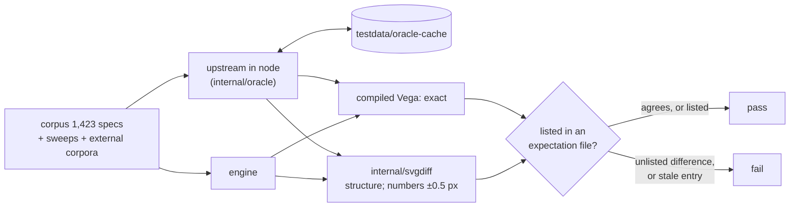

# Testing

Upstream is the oracle. Aster's claim is that it renders what Vega does, so most tests compare its output with upstream Vega and Vega-Lite running in node on the same input. A difference fails the test unless it is listed, with its reason, in an expectation file. A listed difference that has gone away fails too.

```bash
make test                                   # go test -short ./... — no node needed (recorded vectors)
(cd testdata/oracle-node && npm ci)         # once: upstream pinned, node version in package.json (volta)
(cd testdata/oracle-node-vl5 && npm ci)     # Vega-Lite 5.8.0
(cd testdata/mermaid && npm ci)             # the docs' diagram renderer
go test ./...                               # tests that need the oracle skip without it
ASTER_ORACLE=require go test ./...          # as in CI: fail instead of skipping
make check                                  # every gate CI runs (scripts/check.sh), with a ledger
```

## The oracle

`testdata/oracle-node` pins Vega 6.4.0, Vega-Lite 6.4.3 and resvg, and `testdata/oracle-node-vl5` pins Vega-Lite 5.8.0. Both pin their node version with volta. `internal/oracle` drives them and caches their answers in `testdata/oracle-cache`, which is git-ignored and recreated on demand. Delete it to force fresh answers.



The SVG is compared structurally: element tree, attributes, and numbers within half a pixel, since the two sides shape text with different engines (forme here, node-canvas there). The compiled Vega is compared exactly. The comparisons render as upstream does, past the errors it logs (`WithErrorHandler` returning nil), because that is what they compare. PNG output is compared with resvg's rendering of the same SVG, run by the same oracle.

## The corpus

`TestCompareWithNode` (`compare_test.go`) runs over 1,423 specs: 260 Vega fixtures, 332 Vega-Lite fixtures, Vega's 92 example specs, the 627 Vega-Lite examples, 23 vl-convert specs, and 89 fuzz-found regressions (`testdata/corpus/regress`). The specs it does not match are listed with the reason in `testdata/oracle-expect.txt`. All five entries depend on the platform node runs on (emoji measurement in macOS's Pango, d3-cloud's rasterization, V8's last-bit trigonometry on x86-64). So the count that matches is 1,420 on macOS/arm64 and 1,421 on Linux/x86-64. The compiled Vega is identical to upstream's for every Vega-Lite spec.

`go test -run TestCompareWithNode -v . -args -compare.report=/tmp/report.md` writes a per-spec report. `-compare.run name` compares one spec.

## Sweeps

Beyond the corpus, the same comparison runs over generated and collected inputs. Each has an expectation file under `testdata/sweeps` listing, with a reason, every case that is not `ok`, and a floor on its case count, so that a generator that quietly produces fewer cases fails.

| Sweep | Cases | Floor | What it probes |
|---|---:|---:|---|
| `TestSweepVegaSchema` | 7,549 | 7,549 | one chart per (property, value) Vega's schema declares |
| `TestSweepVegaLiteSchema` | 27,513 | 27,513 | the same over Vega-Lite's schema, comparing the compiled Vega |
| `TestSweepValues` | 500 | 500 | untidy data (NaN, ±Infinity, -0, null, empty strings, words where numbers go, non-ASCII text) through stacks, scales, aggregates and axes |
| `TestSweepSignals` | 166 | 166 | signal writes after the first render, re-run as `View.signal` + `runAsync` would |
| `TestSweepTimezones` | 801 | 801 | local time in nine zones around 2024's daylight-saving transitions, node running with that `TZ` |
| `TestSweepLocales` | 372 | 372 | every d3 number and time locale, through axes, legends, formats and parses |
| `TestCorpusWild` | 1,981 | 1,981 | Vega-Lite specs collected from the wild (chart-llm, pinned; [corpora](../testdata/corpora/README.md)) |
| `TestCorpusDeneb` | 62 | 62 | Deneb's templates and examples (pinned) |

All of them agree with upstream except a handful of CJK and emoji cases, where neither side has the glyphs and what node measures depends on the platform's font fallback. `scripts/fetch-corpora.sh` fetches the two external corpora (`-sweep.report dir` writes per-case TSVs).

## Upstream's own test suites

`scripts/record-upstream-vectors.sh` runs the test files of the Vega and d3 packages it lists (30; 29 record calls), at the installed versions and from their git tags, and records every call they make with upstream's answer in `testdata/upstream-vectors-cache` (git-ignored). The 34 `TestUpstream*` tests in `internal/` replay the vectors of 25 of those packages against the engine and require exact equality, with floors totalling 21,523 calls. They skip without the vectors (and fail with `ASTER_ORACLE=require`). Known divergences are listed with their cause in `testdata/upstream-vectors/known-divergences.txt`, some only for the architecture node recorded them on, and are asserted both ways.

## Unit tests without node

Each package that needs upstream's answers keeps a generator beside its tests: `<pkg>/testdata/gen_*.mjs`, or `internal/vega/gen_*.mjs`. Each also keeps the recorded output, so `go test -short ./...` needs neither node nor network. To regenerate, run a generator with `NODE_PATH` pointing at the oracle's modules:

```bash
NODE_PATH=testdata/oracle-node/node_modules node internal/scale/testdata/gen_ticks.mjs | gzip -9 > internal/scale/testdata/ticks.json.gz
```

Vega 6 modules are ESM, which ignores `NODE_PATH`, so generators resolve modules explicitly:

```js
import { createRequire } from 'node:module';
import path from 'node:path';
const require = createRequire(path.join(process.env.NODE_PATH, 'x.js'));
const vega = await import(require.resolve('vega'));
```

## Robustness

- **Differential fuzzing:** `ASTER_FUZZ=3000 go test -run TestFuzzDifferential -v -timeout 3h .` mutates corpus specs and renders each mutant on both sides, checking the engine for panics and a time budget. Each disagreement is triaged into a fix with a regression spec under `testdata/corpus/regress`, or into a stated reason.
- **Coverage-guided fuzzing:** each parser has a `go test -fuzz` target, listed in `scripts/fuzz-targets.txt` (29 of them; `TestFuzzTargetsListed` keeps the list complete). `make fuzz` runs them (`FUZZTIME=30s` for a short pass), and the nightly `fuzz.yml` workflow runs each for minutes, keeping its corpus. Besides "no panic, bounded time" they check properties: the JSON reader agrees with `encoding/json`, the SVG writer writes only its own elements and attributes, and its output parses back to exactly the structure it wrote, so no string in a scene made markup (`internal/svgcheck`; `TestValuesCreateNoStructure` and `TestSpecAndDataStringsMakeNoMarkup` give every property, spec value and data field such a string), and every PDF reads back with pdf0. A crasher is fixed and kept under the package's `testdata/fuzz/`.
- **The comparator is tested:** `internal/svgdiff` is mutation-tested. Each of 336 kinds of change over 718 documents must be reported.
- **Untrusted input:** `TestDeepInput` drives 69 deeply nested shapes to depths up to 100,000 in child processes with a capped stack. `go run ./internal/cmd/recursionaudit` finds every recursion in the call graph (113 cycles) and checks each against `scripts/recursion.allow`, which says how it is bounded. The security reproducers are described in [security-review-2026.md](history/security-review-2026.md).
- **Bounded inputs:** `TestBoundedInputs` renders every file under `testdata/security/bounded` to every output its kind has, each in a child process (`harness_security_test.go`), under `WithMemoryLimit(64 MiB)` and `WithTimeout(2 s)`. Each render must return within the timeout plus 0.5 s, with a peak heap under four times the limit, and end in success or an error wrapping `ErrLimit` or `context.DeadlineExceeded`: a child killed at its 1 GiB heap cap or 15 s wall cap, a panic, an "internal error" or any other error fails the test. It runs in every `go test`, `-short` included, four children at a time ([ADR 0010](adr/0010-bounds-charged-where-work-happens.md)). To add a case, add one file:

  | File | Kind | Outputs rendered |
  |---|---|---|
  | `name.vg.json` | Vega | SVG, PNG, PDF |
  | `name.vl.json` | Vega-Lite | compiled Vega, SVG, PNG, PDF |
  | `name.svg` | SVG input | `SVGToPNG`, `SVGToPDF` |
  | `name.png.svg` | SVG input only the rasterizer draws (filters, style sheets) | `SVGToPNG` |
  | `name.ttf`, beside one of the above | a font | registered as family `Evil` for that input |
  | `name.quantize.<ext>` | any of the above | its PNG outputs with `WithQuantizePNG(256)` |

  A case is self-contained: no Loader is configured, so its data is inline. It must be valid for every output it has (an SVG that `SVGToPDF` refuses as unsupported fails the test). The reproducer of a fixed resource finding belongs here, named after what it does (`regex-program-20x.vg.json`), so the bound it proves stays proved. The heavier reproducers under `testdata/security` run with `ASTER_SECURITY=1`.
- **Floating point:** `scripts/fmacheck.sh` rejects fused multiply-adds the Go compiler could introduce on arm64 where V8 does not have them ([design-rules.md](design-rules.md#floating-point-parity)).
- **Concurrency:** `go test -race`; `TestConcurrentConverterSharesNothing` with `ASTER_STRESS_FULL=1` renders the whole corpus from 12 goroutines on one Converter.
- **Colour glyphs and PDF:** colour glyphs are compared with HarfBuzz's drawing of the same fonts (`hb-view`, images in `testdata/colourfonts`). The PDFs are read back with PDFium, Chrome's PDF engine, and compared with the PNGs (`TestPDFium*`). That needs a Python with pypdfium2:

  ```sh
  python3 -m venv .pdfium && .pdfium/bin/pip install --require-hashes -r scripts/pdfium/requirements.txt
  ASTER_PDFIUM=.pdfium/bin/python go test ./internal/svgpdf -run TestPDFium
  ```

- **Performance:** `BenchmarkScenes`; `ASTER_PERF=1 go test -run TestPerfReport -v .` (per stage); CI's benchmark gate, see [performance.md](performance.md#regressions).
- **Docs:** `TestLimitsDocMatchesCode` checks [limits.md](limits.md) against the code, and `TestPackageLayers` checks [architecture.md](architecture.md#package-layers). `TestDocsMermaid` renders every Mermaid diagram in the repository's Markdown with Mermaid's own renderer, pinned in `testdata/mermaid` (`(cd testdata/mermaid && npm ci)`). It runs on jsdom rather than a browser, so text sizes are estimated, but parsing, layout and SVG writing all run, and a diagram GitHub would show as an error fails the test. `MERMAID_OUT=dir` keeps the SVGs for a look. `TestDocsLinks` checks that every relative link in the repository's Markdown reaches a file, and a heading for a `#fragment`.

## Environment variables

| Variable | Effect |
|---|---|
| `ASTER_ORACLE=require` | tests that need node or the upstream vectors fail instead of skipping |
| `ASTER_ORACLE_PROCS=n` | node processes the oracle runs |
| `ASTER_FUZZ=n` (`ASTER_FUZZ_SEED`, `_START`, `_WORKERS`, `_BUDGET`, `_ORACLE`, `_OUT`) | run and steer the differential fuzzer |
| `ASTER_PDFIUM=path` | the Python with pypdfium2, for `TestPDFium*` |
| `ASTER_PERF=1` | run `TestPerfReport` |
| `ASTER_SECURITY=1` | run the heavy resource reproducers ([security-review-2026.md](history/security-review-2026.md)) |
| `ASTER_STRESS_FULL=1` | the concurrency stress test over the whole corpus |
| `ASTER_MEMCHECK=1` (`_OUT`, `_CASES`, `_LIMITS`) | measure the heap of adversarial renders under `WithMemoryLimit` |
| `FUZZTIME`, `FUZZMINIMIZETIME` | `make fuzz` time per target |
| `BENCHGATE_*`, `BENCHSTAT` | `scripts/benchgate.sh` thresholds and tools (see the script) |
| `RECORD_FORCE=1` | re-record the upstream vectors even when up to date |

Packages have further debugging knobs, documented where they are read (`grep -rn 'Getenv' --include=*_test.go`).
