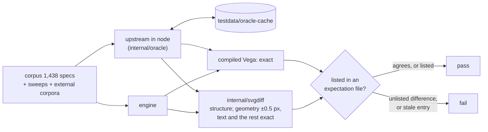

# Testing

Upstream is the oracle. Aster's claim is that it renders what Vega does, so most tests compare its output with upstream Vega and Vega-Lite running in node on the same input. A difference fails the test unless it is listed, with its reason, in an expectation file. A listed difference that has gone away fails too.

```bash
make test                                   # go test -short ./... — no node needed; ends with what skipped, and why
(cd testdata/oracle-node && npm ci)         # once: upstream pinned, node version in package.json (volta)
(cd testdata/oracle-node-vl5 && npm ci)     # Vega-Lite 5.8.0
(cd testdata/mermaid && npm ci)             # the docs' diagram renderer
go test ./...                               # tests that need the oracle skip without it
ASTER_ORACLE=require go test ./...          # as in CI: fail instead of skipping
make check                                  # every gate CI runs (scripts/check.sh), with a ledger
```

## The oracle

`testdata/oracle-node` pins Vega 6.4.0, Vega-Lite 6.4.3 and resvg, and `testdata/oracle-node-vl5` pins Vega-Lite 5.8.0. Both pin their node version with volta, 24.21.0, which CI installs (`node-version-file`) and the oracle runs under wherever volta is installed (it starts node in the module set's directory). Run the oracle, and record upstream's vectors, under that version only: another node's V8 can differ in the last bit of some `Math` functions (node 26's does), which shows as differences that are not the engine's. Both refuse another node: the oracle as if it were not installed (its tests skip, or fail with `ASTER_ORACLE=require`), `scripts/record-upstream-vectors.sh` with an error, unless `ASTER_ORACLE_ANY_NODE=1` says to use it anyway. The cache key covers everything the oracle's answers depend on: node's version and platform, the text stack, the scripts and lockfiles, the dataset URL patterns, the datasets it serves and the fonts it measures with. `internal/oracle` drives them and caches their answers in `testdata/oracle-cache`, which is git-ignored and recreated on demand. Delete it to force fresh answers.



The SVG is compared structurally: element tree and attributes, the numbers of geometry attributes (coordinates, lengths, path data, transforms) within half a pixel, since the two sides shape text with different engines (forme here, node-canvas there), and text and every other attribute exactly, so a label `0.25` is not `0.5`, nor `1e+3` `1000`, nor an opacity of 0.2 one of 0.6. Half a pixel is a tolerance on pixels only: a number in another unit (a gradient's or pattern's bounding-box coordinates, `rotate`'s and `skew`'s angles, `scale`'s factors) is compared within a relative 1e-6. An oracle request that node does not answer within two minutes fails the test, as does one the oracle cannot answer for a reason of its own (resvg-napi not loading, a sweep generator throwing: `oracleErr`, `oracle.ErrFailed`); neither is cached or counted as upstream rejecting the input. Where both sides fail, they agree only if the engine refused the input: an engine panic (an "internal error") fails every differential gate whatever node answered, and no expectation file may list it. The compiled Vega is compared exactly. The comparisons render as upstream does, past the errors it logs (`WithErrorHandler` returning nil), because that is what they compare. PNG output is compared with resvg's rendering of the same SVG, run by the same oracle.

## The corpus

`TestCompareWithNode` (`compare_test.go`) runs over 1,438 specs: 260 Vega fixtures, 332 Vega-Lite fixtures, Vega's 92 example specs, the 627 Vega-Lite examples, 23 vl-convert specs, and 104 regressions (`testdata/corpus/regress`). The specs it does not match are listed with the reason in `testdata/oracle-expect.txt`. Five of its six entries depend on the platform node runs on (emoji measurement in macOS's Pango, d3-cloud's rasterization, V8's last-bit trigonometry on x86-64); the sixth is a chart node's renderer cannot draw (upstream's compiler writes onto `Object.prototype` for a field named `__proto__`, and node's Vega then overflows its stack). So the count that matches is 1,423 on macOS/arm64 and 1,424 on Linux/x86-64. The compiled Vega is identical to upstream's for every Vega-Lite spec, and where node compiles a spec the engine must compile it too, even when both then fail.

A platform-dependent entry gives one status per platform, each keyed to what the oracle's version line reports: `ok@pango-1.57|differ@pango-1.48` (the Pango node-canvas was built with), `ok@arm64|differ@x64` (node's architecture). Exactly one alternative applies where the oracle runs, and that status is expected there, so the case is checked on every platform rather than accepted with either outcome (`expect_test.go`). An entry whose case no longer exists fails a complete run. The word cloud is the one chart whose layout follows the platform's glyph rasterization (d3-cloud reads node-canvas's pixels), so `TestWordcloudMatchesNodeOnABoxCanvas` also compares the transform on every platform: both sides lay words out on the same deterministic canvas (`testdata/oracle-node/wordcloud-box.mjs`, `wordcloud.BoxRenderer`), over variants of every parameter.

`go test -run TestCompareWithNode -v . -args -compare.report=/tmp/report.md` writes a per-spec report. `-compare.run name` compares one spec.

## Sweeps

Beyond the corpus, the same comparison runs over generated and collected inputs. Each has an expectation file under `testdata/sweeps` listing, with a reason, every case that is not `ok`, and a floor on its case count, so that a generator that quietly produces fewer cases fails.

| Sweep | Cases | Floor | What it probes |
|---|---:|---:|---|
| `TestSweepVegaSchema` | 7,549 | 7,549 | one chart per (property, value) Vega's schema declares |
| `TestSweepVegaLiteSchema` | 27,513 | 27,513 | the same over Vega-Lite's schema, comparing the compiled Vega |
| `TestSweepValues` | 500 | 500 | untidy data (NaN, ±Infinity, -0, null, empty strings, words where numbers go, non-ASCII text) through stacks, scales, aggregates and axes |
| `TestSweepSignals` | 166 | 166 | signal writes after the first render, re-run as `View.signal` + `runAsync` would |
| `TestSweepTimezones` | 801 | 801 | local time in nine zones around 2024's daylight-saving transitions, node running with that `TZ` |
| `TestSweepLocales` | 372 | 372 | every d3 number and time locale, through axes, legends, formats and parses |
| `TestCorpusWild` | 1,981 | 1,981 | Vega-Lite specs collected from the wild (chart-llm, pinned; [corpora](../testdata/corpora/README.md)) |
| `TestCorpusDeneb` | 62 | 62 | Deneb's templates and examples (pinned) |

All of them agree with upstream except a handful of CJK and emoji cases, where neither side has the glyphs and what node measures depends on the platform's font fallback, and one log scale's legend gradient, a stop of which V8's x86-64 build rounds differently from its arm64 build (which the engine follows). `scripts/fetch-corpora.sh` fetches the two external corpora (`-sweep.report dir` writes per-case TSVs).

## The type-confusion differential

`TestVegaLiteTypeConfusionMatchesNode` (`vltypeconfusion_oracle_test.go`) replaces one value of a corpus spec (`internal/vegalite/testdata/specs`) and compiles the mutant with the engine and with node, for Vega-Lite 6.4 and 5.8. The engine must fail where node throws, compile where node compiles, log node's warnings in order and count (each of node's cut first as the engine cuts every warning, to 1 KiB with an ellipsis: `oracle.WarningsMatch`, which every differential that compares warnings uses), and produce node's compiled Vega exactly ([ADR 0013](adr/0013-invalid-input-fails-where-upstream-throws.md)). The mutator, `internal/fuzzutil/confusion` (shared with internal/vegalite's `TestTypeConfusion`, which checks only that nothing panics), makes half its mutants with a value of the wrong type from a fixed list, and half from the value it replaces: `[v]`, `[[v]]`, `String(v)`, `Number(v)`, `[...v, null]`, a case-mapped spelling or one with a dotted İ, a dotless ı, the Kelvin sign or a long ſ, another string of the spec as it is or as `[text]`, `[...v, [v[i]]]`, a `"__proto__"` member of `null`, `{}` or an object holding another member of the spec added to an object, or the key renamed to `"undefined"`, `""`, `"__proto__"`, `"constructor"`, `"toString"` or `"valueOf"` ([ADR 0026](adr/0026-keywords-read-as-upstream-reads-them.md)). Flags: `-typeconfusion.seed`, `-typeconfusion.n` (mutants; 1,500 by default), `-typeconfusion.budget` (stop after a duration) and `-typeconfusion.dump dir` (writes the first mutant of each difference as `NNNN-VERSION.json`, with its description in `.key`). The suite runs the default seed; with the derived vocabulary (the sibling-text, `[...v, [v[i]]]`, `"__proto__"` and `toString`/`valueOf` forms included), seeds 1, 7, 11, 13, 17, 20740, 20741 and 20742 (50,000 mutants each) and 43, 47, 53, 59, 61 and 67 (10,000 each) and 23 (100,000) report no difference (2026-10-19). Before the vocabulary was derived (with the fixed list alone), seeds 7 to 67 (10,000 each), 20740 (784,629, a nightly run's), 20741 (816,352) and 20742 (1,272,702) reported none.

The search is continuous: the `typeconfusion` job of `.github/workflows/fuzz.yml` runs it nightly on the macOS arm64 runner, where node's V8 computes `Math` as the engine does (`internal/jsmath` follows arm64 V8 bit for bit), with a new seed (the day number), as many mutants as its budget allows, against node 24 with a cold oracle cache, and uploads the dumped mutants as the `typeconfusion-seed-N` artifact when it finds a difference. A manual run of the workflow can name the seed and the budget.

To turn a found divergence into a regression case:

1. Reproduce it: `ASTER_ORACLE=require go test -run 'TestVegaLiteTypeConfusionMatchesNode$' . -args -typeconfusion.seed N -typeconfusion.n M -typeconfusion.dump /tmp/tc` (`M` at least the run's mutant count, which the log reports), or take the mutant from the artifact.
2. Copy the mutant to `testdata/typeconfusion/`, named for what it changes, with the seed and the version: `repeat-null-seed43-6.4.json`. `TestTypeConfusionRegressionsMatchNode` replays every file there against node, so the case stays covered whatever the corpus becomes; check that it fails.
3. Find where upstream diverges: compile the mutant in node with the stack of the throw, or diff the compiled Vega (`firstJSONDiff` names the first difference), and read the upstream source at that site (both versions: 5.8's predicates often differ from 6.4's).
4. Mirror upstream's JavaScript there, as ADR 0013 describes: the TypeError with its text, the conversion a template or an operator applies, the plain-object semantics of a map keyed by name (`jsRealm`). Fix the class, not the instance: grep upstream for the same idiom.
5. Check that the regression passes and the seeds above still report no difference; a spec worth keeping in the rendered corpus as well goes to `testdata/corpus/regress`.

### Vega

`TestVegaTypeConfusionMatchesNode` (`vgtypeconfusion_oracle_test.go`) is the same differential for Vega input. It mutates one value of a spec of the Vega corpora (`vg-fixtures`, `vg-gallery`, `regress-vg`; the specs whose unmutated comparison is ok): a value of another type, a value derived from the one replaced (`[v]`, `[[v]]`, `String(v)`, `Number(v)`, `[...v, null]`), or a key renamed to `"undefined"`, `""`, `"__proto__"`, `"constructor"`, `"toString"`, `"hasOwnProperty"` or a case-mapped spelling. It renders the mutant with the engine and with node: the engine must fail where node throws and render where node renders, an SVG equal as the corpus comparison holds them ([ADR 0013](adr/0013-invalid-input-fails-where-upstream-throws.md)). An engine panic is a failure whatever node answered; a render the engine stops at one of its bounds (`ErrLimit`, the timeout) and a mutant node does not answer (it timed out or died) are counted in the log, not compared. Flags: `-vgconfusion.seed`, `-vgconfusion.n` (1,500 by default), `-vgconfusion.budget`, `-vgconfusion.paths` (a regular expression on the mutated slot's path, indices written `/N`, for a search of one part of a spec) and `-vgconfusion.dump dir` (the first mutant of each difference as `NNNN.vg.json`, its key, corpus spec and first difference in `NNNN.key`). `-vgconfusion.replay dir` makes `TestVegaTypeConfusionRegressionsMatchNode` replay a dump directory instead of the recorded regressions, to see which differences remain after a fix. The `vgtypeconfusion` job of `.github/workflows/fuzz.yml` runs it nightly as the Vega-Lite one is run, on the macOS arm64 runner too. A divergence becomes a regression case as above, its mutant (the smallest that reproduces it) in `testdata/vgtypeconfusion` (named for what it changes, `.vg.json`), which `TestVegaTypeConfusionRegressionsMatchNode` replays; check that it fails before the fix. `-vgconfusion.svgs dir` makes that replay write each failing mutant's two SVGs (`NAME.engine.svg`, `NAME.node.svg`) to `dir`, to diff them. The mutator draws half the replacements under `/data/N/values` from the names of `Object.prototype` members. Differences that remain on a host whose V8 is not arm64's, which is why the nightly runs on arm64: the groups of a force-directed or beeswarm layout and of a trail mark's arc (`Math.sin`, `Math.atan2` in the last place; [ADR 0013](adr/0013-invalid-input-fails-where-upstream-throws.md) lists them with the others it does not match). The oracle process is replaced after a request that could leave state behind (a rejected canvas font, a d3-geo area, bounds or centroid call, a `__proto__`, a failed canary render), so a recorded answer does not depend on request order; a cached answer from before that change is recomputed (the cache key covers the script).

## Upstream's own test suites

`scripts/record-upstream-vectors.sh` runs the test files of the Vega and d3 packages it lists (30; 29 record calls), at the installed versions and from their git tags, and records every call they make with upstream's answer in `testdata/upstream-vectors-cache` (git-ignored). The 34 `TestUpstream*` tests in `internal/` replay the vectors of 25 of those packages against the engine and require exact equality, each with a floor at the count it replays today, 26,366 calls in all (raise a floor when vectors are added). They skip without the vectors (and fail with `ASTER_ORACLE=require`). The recording's fingerprint covers node's version and architecture, and is written only when every package was recorded, so an interrupted or partial recording is recorded again. Known divergences are listed with their cause in `testdata/upstream-vectors/known-divergences.txt`, some only for the architecture node recorded them on, and are asserted both ways; a line naming a package the recorder does not record, or an architecture node never reports, fails. Each pins a hash of both answers, upstream's and the engine's, so it accepts that divergence and no other; a long signature ends in a hash of the whole call; a line that names no recorded vector fails. CI's oracle job runs on x86-64 Linux, so the lines for other architectures, and the macOS alternatives of the expectation files, are checked only where someone runs the oracle there.

## Unit tests without node

Each package that needs upstream's answers keeps a generator beside its tests: `<pkg>/testdata/gen_*.mjs`, or `internal/vega/gen_*.mjs`. Each also keeps the recorded output, so `go test -short ./...` needs neither node nor network.

A recorded file is only worth what its claim to be upstream's answer today is worth, so every one is listed, with the command that records it, in `testdata/vectors.txt`, and `go run ./internal/cmd/vectors` (`make vectors`) regenerates them all with the pinned node in a scratch copy and fails on any difference (`-repeat 2` also fails a generator whose output varies between runs; the heavy `vectors` job runs it on Linux x86-64 and macOS arm64). A recording that depends on the platform (V8's last-bit arithmetic follows the architecture, Math.pow the C library) names the one it must come from, and is checked, and recorded, only there. `-write` re-records in place and updates `testdata/vectors.lock`, a fingerprint per file of its generator and the modules it imports, its inputs, its command, the lockfile, the pinned node and the outputs themselves; `TestVectorFingerprints` checks the lock without node in every `go test`, so a generator or an input edited without re-recording, or an output edited by hand, fails at once, and `TestEveryGeneratorIsInTheManifest` keeps every generator listed. Three recordings follow arm64 V8's last-bit arithmetic exactly, as the engine does, and are pinned to darwin-arm64: the geo vectors, `internal/expr`'s `math_bits` and the scene corpus (which also reads the example data under docs/data of upstream's repository at the installed tag, which `scripts/record-upstream-vectors.sh` clones into the git-ignored upstream clones directory). The scenegraph generators record without node-canvas (`testdata/oracle-node/no-canvas-hook.mjs`: text measured with Vega's estimate, image URLs kept) and with timers frozen at the first frame, as the runtime renders. `internal/vega`'s corpus comparisons (`TestCorpus`, `TestCorpusSVG`, `TestVegaLiteScenes`) fail on any spec that does not match its recording unless `knownmismatch_test.go` lists it with the reason. The upstream vectors of `internal/jsmath` are recorded by its own `-update`, which refuses a platform whose answers the engine does not follow. To run one generator by hand, point `NODE_PATH` at the oracle's modules:

```bash
NODE_PATH=testdata/oracle-node/node_modules node internal/scale/testdata/gen_ticks.mjs | gzip -9 > internal/scale/testdata/ticks.json.gz
```

The expression language's builtins differential is one of them: `internal/expr/testdata/gen_builtins.mjs` evaluates about 14,000 expressions with upstream's View (each alone, in a formula over one datum, in a child process with a bounded heap, so that one upstream cannot finish is recorded as such), and records each result, error and the warnings `warn()` logs. Every function of the table is called with nominal arguments, with each argument replaced by one of 35 edge values (strings, null, undefined, NaN, arrays, objects, a date, a pattern, a colour), and with each argument wrapped in `warn()`, which records the order upstream evaluates them in. It also reads every member each kind of value inherits, and records which UTF-16 code units the parser takes in an identifier. `TestBuiltinsDifferential` and `TestIdentifierCharacters` replay it exactly (results within two units in the last place for the functions that go through `Math`'s transcendental functions), and `TestBuiltinsDifferentialCoversEveryFunction` requires every function to be in it. Regenerate it with `TZ=UTC` (about a minute):

```bash
NODE_PATH=testdata/oracle-node/node_modules TZ=UTC node internal/expr/testdata/gen_builtins.mjs | gzip -9n > internal/expr/testdata/builtins.json.gz
```

Vega 6 modules are ESM, which ignores `NODE_PATH`, so generators resolve modules explicitly:

```js
import { createRequire } from 'node:module';
import path from 'node:path';
const require = createRequire(path.resolve(process.env.NODE_PATH, 'x.js')); // resolve: a relative NODE_PATH is not a path node 24 takes
const vega = await import(require.resolve('vega'));
```

## Robustness

- **Differential fuzzing:** `ASTER_FUZZ=3000 go test -run TestFuzzDifferential -v -timeout 3h .` mutates corpus specs and renders each mutant on both sides, checking the engine for panics and a time budget. Each disagreement is triaged into a fix with a regression spec under `testdata/corpus/regress`, or into a stated reason. A panic fails the run, the Vega-Lite compiler's included, as does a mutant node compiles and the engine does not.
- **Coverage-guided fuzzing:** each parser has a `go test -fuzz` target, listed in `scripts/fuzz-targets.txt` (29 of them; `TestFuzzTargetsListed` keeps the list complete). `make fuzz` runs them (`FUZZTIME=30s` for a short pass), and the nightly `fuzz.yml` workflow runs each for minutes, keeping its corpus. A failing seed-corpus entry fails the run even when its message says "context deadline exceeded", which `scripts/fuzz.sh` otherwise reads as the fuzz time running out while minimizing. Besides "no panic, bounded time" they check properties: the JSON reader agrees with `encoding/json`, the SVG writer writes only its own elements and attributes, and its output parses back to exactly the structure it wrote, so no string in a scene made markup (`internal/svgcheck`; `TestValuesCreateNoStructure` and `TestSpecAndDataStringsMakeNoMarkup` give every property, spec value and data field such a string), and every PDF reads back with pdf0. A crasher is fixed and kept under the package's `<pkg>/testdata/fuzz/`.
- **The comparator is tested:** `internal/svgdiff` is mutation-tested. Each of 375 kinds of change over 694 documents must be reported, a change within the geometry tolerance to any other number, to a number that is not a pixel (a gradient's bounding-box coordinate, a rotation angle) or to text included.
- **Untrusted input:** `TestDeepInput` drives 69 deeply nested shapes to depths up to 100,000 in child processes with a capped stack. `go run ./internal/cmd/recursionaudit` finds every recursion in the call graph (113 cycles) and checks each against `scripts/recursion.allow`, which says how it is bounded. The security reproducers are described in [security-review-2026.md](history/security-review-2026.md).
- **Bounded inputs:** `TestBoundedInputs` renders every file under `testdata/security/bounded` to every output its kind has, each in a child process (`harness_security_test.go`), under `WithMemoryLimit(64 MiB)` and `WithTimeout(2 s)`. Each render must return within the timeout plus 0.35 s, with a peak heap under four times the limit, and end in success or an error wrapping `ErrLimit` or `context.DeadlineExceeded`: a child killed at its 1 GiB heap cap or 15 s wall cap, a panic, an "internal error" or any other error fails the test. An error message in which a part repeats (a package prefix, or a whole cause, as in `raster: …: raster: limit exceeded`) fails it too. It runs in every `go test`, `-short` included, four children at a time ([ADR 0010](adr/0010-bounds-charged-where-work-happens.md)). To add a case, add one file:

  | File | Kind | Outputs rendered |
  |---|---|---|
  | `name.vg.json` | Vega | SVG, PNG, PDF |
  | `name.vl.json` | Vega-Lite | compiled Vega, SVG, PNG, PDF |
  | `name.svg` | SVG input | `SVGToPNG`, `SVGToPDF` |
  | `name.png.svg` | SVG input only the rasterizer draws (filters, style sheets) | `SVGToPNG` |
  | `name.ttf`, beside one of the above | a font | registered as family `Evil` for that input |
  | `name.quantize.<ext>` | any of the above | its PNG outputs with `WithQuantizePNG(256)` |
  | `name.loader`, beside one of the above | the harness Loader it renders with: `record` (a tiny body for every URL) or `bigcsv:N` (N MiB of CSV) | |

  A case is self-contained: without a `.loader` file no Loader is configured, so its data is inline. It must be valid for every output it has (an SVG that `SVGToPDF` refuses as unsupported fails the test). The reproducer of a fixed resource finding belongs here, named after what it does (`regex-program-20x.vg.json`), so the bound it proves stays proved. The heavier reproducers under `testdata/security` run with `ASTER_SECURITY=1`, in CI's `security` job.
- **Floating point:** `scripts/fmacheck.sh` rejects fused multiply-adds the Go compiler could introduce on arm64 where V8 does not have them ([design-rules.md](design-rules.md#floating-point-parity)). It fails on a stale allowlist entry, on a failed build, and when it sees no fused instruction at all (positions it cannot match, as `-trimpath` makes them); it unsets `GOFLAGS`.
- **Time:** a wall-clock (or CPU-time) limit in a test exists to signal unbounded or quadratic behaviour, not to measure speed. Each one is calibrated at 2x the time CI measured, with a 1 s floor (where a wall clock measures the runner's scheduling, not the code), rounded up to a readable value, and the baseline is written next to the limit. A post-deadline allowance (how long after a deadline a call may still return) is 2x the measured overshoot, rounded up to 50 ms, never below 250 ms. A run more than 2x slower than that is a finding to investigate, not a reason to raise the limit. A limit scales by `internal/testutil`'s `RaceSlowdown` (`Scaled`), and its baseline is the larger of the worst time without `-race` and the worst under `-race` divided by `RaceSlowdown`. A pure hang guard (a child process's kill wall, a `select` on a timer that only stops a stuck test) keeps a large value and its comment says "hang guard, not a calibrated bound". To re-measure, dispatch the Heavy gates workflow with `timings=true` (every wall-clock site records its measured value and limit through `testutil.Timing`) and run `scripts/timings.sh` over the jobs' logs or `timings.tsv` artifacts. Precise properties are counted, not timed: a complexity guard counts deterministic work (steps, comparisons, work charged to the ledger) at n and 2n and bounds the ratio of the counts; no test compares times, which flaked on CI runners. `TestNoUnscaledWallClockBounds` fails on a comparison of `time.Since(…)` with an unscaled constant in any tracked test file.
- **Concurrency:** `go test -race`; `TestConcurrentConverterSharesNothing` with `ASTER_STRESS_FULL=1` renders the whole corpus from 12 goroutines on one Converter.
- **Colour glyphs and PDF:** colour glyphs are compared with HarfBuzz's drawing of the same fonts (`hb-view`, images in `testdata/colourfonts`). The PDFs are read back with PDFium, Chrome's PDF engine, and compared with the PNGs (`TestPDFium*`). That needs a Python with pypdfium2:

  ```sh
  python3 -m venv .pdfium && .pdfium/bin/pip install --require-hashes -r scripts/pdfium/requirements.txt
  ASTER_PDFIUM=.pdfium/bin/python go test ./internal/svgpdf -run TestPDFium
  ```

- **Performance:** `BenchmarkScenes`; `ASTER_PERF=1 go test -run TestPerfReport -v .` (per stage); CI's benchmark gate, see [performance.md](performance.md#regressions). A benchmark times only its loop: `for b.Loop()`, or a `b.N` loop with `b.ResetTimer()` after its setup, which `TestBenchmarksTimeOnlyTheLoop` checks in every test file.
- **Docs:** `TestLimitsDocMatchesCode` checks [limits.md](limits.md) against the code, and `TestPackageLayers` checks [architecture.md](architecture.md#package-layers). `TestDocsMermaid` renders every Mermaid diagram in the repository's Markdown with Mermaid's own renderer, pinned in `testdata/mermaid` (`(cd testdata/mermaid && npm ci)`). It runs on jsdom rather than a browser, so text sizes are estimated, but parsing, layout and SVG writing all run, and a diagram GitHub would show as an error fails the test. `MERMAID_OUT=dir` keeps the SVGs for a look. `TestDocsLinks` checks that every relative link in the repository's Markdown (inline, reference and HTML) reaches a tracked file, and a heading for a `#fragment`; it and `TestDocsMermaid` read only tracked files, as GitHub does, fences at any indentation included. `TestFixedLimitsDocMatchesCode` checks the fixed bounds of limits.md, number by number, against the constants that enforce them, and `TestDependencyStatement` architecture.md's list of modules against `go list`.

## Environment variables

| Variable | Effect | In CI |
|---|---|---|
| `ASTER_ORACLE=require` | tests that need node or the upstream vectors fail instead of skipping | the `oracle` job |
| `ASTER_ORACLE_PROCS=n` | node processes the oracle runs | a knob (default: half the CPUs) |
| `ASTER_ORACLE_ANY_NODE=1` | run the oracle, and record the upstream vectors, under a node other than the pinned one | no: CI installs the pinned node |
| `ASTER_FUZZ=n` (`ASTER_FUZZ_SEED`, `_START`, `_WORKERS`, `_BUDGET`, `_ORACLE`, `_OUT`) | run and steer the differential fuzzer | no: hours with the oracle, and exploratory; what it finds is fixed and kept under `testdata/corpus/regress`, which CI compares |
| `ASTER_PDFIUM=path` | the Python with pypdfium2, for `TestPDFium*` | the `pdfium` job |
| `ASTER_POPPLER=require` | the tests that read PDFs back with poppler (`pdftotext`, `pdftoppm`) fail instead of skipping without it | the `pdfium` job |
| `ASTER_PERF=1` | run `TestPerfReport` | no: a timing report for a quiet machine; the benchmark gate guards regressions |
| `ASTER_SECURITY=1` | run the heavy resource reproducers ([security-review-2026.md](history/security-review-2026.md)) | the `security` job |
| `ASTER_STRESS_FULL=1` | the concurrency stress test over the whole corpus | the `security` job (a sample runs in every `go test`) |
| `ASTER_MEMCHECK=1` (`_OUT`, `_CASES`, `_LIMITS`) | measure the heap of adversarial renders under `WithMemoryLimit`; every case must end in `ErrLimit` at twice the budget, and none in another error | the `security` job, the full matrix (`TestMemoryLimitHeapSmoke` runs in every `go test`) |
| `ASTER_METERING_FULL=1` | `TestEveryBuiltinIsMetered` at full size (1 MiB strings) | the `security` job |
| `FUZZTIME`, `FUZZMINIMIZETIME` | `make fuzz` time per target | the nightly `fuzz.yml` |
| `BENCHGATE_*`, `BENCHSTAT` | `scripts/benchgate.sh` thresholds and tools (see the script) | the `benchgate` job |
| `RECORD_FORCE=1` | re-record the upstream vectors even when up to date | no: the recording is keyed by its inputs |
| `WRITE=1` (`make vectors`) | re-record the committed vector files of `testdata/vectors.txt` | no: the `vectors` job checks them |

The `oracle`, `pdfium`, `security` and `benchgate` jobs are in `.github/workflows/heavy.yml`, which runs on every push to main and by hand on a release candidate; pull requests run the quick gates of `ci.yml` only: the `-short` suite, whose output ends with the tests that skipped and why (`internal/cmd/testsummary`; every oracle comparison skips under `-short`, and the replays of upstream's vectors skip without them), and `TestFixedLimitsDocMatchesCode`, which `-short` skips. `scripts/check.sh` runs what CI runs, these jobs included, and fails when a tool a gate needs is missing (`-allow-missing` records it as skipped instead). The other variables the tests read select or dump specs while debugging (`ASTER_COMPARE`, `ASTER_FULL`, `ASTER_TIME`, `ASTER_VEGA`, `ASTER_DUMP`, `ASTER_COMPARE_DUMP`, `ASTER_DEMO_DIR`, `ASTER_DRIFT_DIR`, `ASTER_GAP_STACKS`, `MERMAID_OUT`) and guard nothing on their own.

Packages have further debugging knobs, documented where they are read (`grep -rn 'Getenv' --include=*_test.go`).
